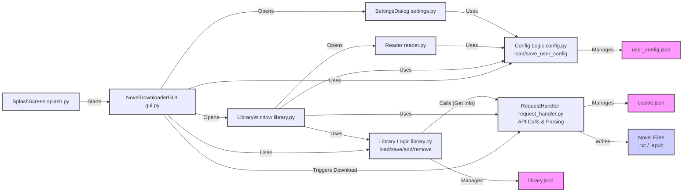

# 📚 番茄小说下载器 | Fanqie Novel Downloader

<div align="center">

[](https://github.com/POf-L/Fanqie-Tomato-Downloader/stargazers)
[](https://github.com/POf-L/Fanqie-Tomato-Downloader/network/members)
[](https://github.com/POf-L/Fanqie-Tomato-Downloader/issues)
[](LICENSE)
[](https://github.com/POf-L/Fanqie-Tomato-Downloader/commits/main)

[](https://github.com/POf-L/Fanqie-Tomato-Downloader/releases)
[](https://github.com/POf-L/Fanqie-Tomato-Downloader/releases)
[](https://github.com/POf-L/Fanqie-Tomato-Downloader/releases)

**🌟 高效、优雅且功能强大的番茄小说下载解决方案 🌟**

</div>

## ✨ 特性

|  |  |
|---|---|
| **📚 高质量内容获取** | **🔄 多格式转换** |
| * 支持番茄小说全平台内容下载  | * 支持输出纯净 TXT 格式 |
| * 智能解析章节结构与内容 | * 生成精美排版的 EPUB 电子书 |
| * 自动校正小说格式与标点 | * 保留原书籍章节结构 |
| **⚡ 高效下载引擎** | **🖥️ 界面体验** |
| * 多线程并发下载技术 | * 直观友好的图形界面 |
| * 智能调节网络请求频率 | * 实时下载进度可视化 |
| * 断点续传与状态恢复 | * 跨平台一致性体验 |

## 🚀 快速开始

### 🌐 在线下载（零安装，零依赖）

<details>
<summary><b>点击展开详细步骤</b></summary>

利用GitHub Actions的强大功能，无需在本地安装任何软件即可下载小说：

1. 在GitHub仓库页面，点击 **"Actions"** 选项卡
2. 左侧选择 **"在线下载小说"** 工作流
3. 点击 **"Run workflow"** 按钮
4. 填写以下信息：
   - **小说ID**：从番茄小说网址中获取（例如：`https://fanqienovel.com/page/123456` 中的 `123456`）
   - **下载线程数**：默认为5，可选1-10
   - **输出格式**：选择txt或epub
5. 点击 **"Run workflow"** 开始下载
6. 下载完成后，点击运行记录中的 **"Summary"** 标签
7. 在 **"Artifacts"** 部分找到并下载小说文件（保存期限为7天）

</details>

### 📦 一键式安装与使用

<details>
<summary><b>点击查看各平台预编译版本</b></summary>

从 [📥 官方发布页](https://github.com/POf-L/Fanqie-Tomato-Downloader/releases) 下载适合您系统的预编译版本：

| 平台 | 下载链接 | 说明 |
|------|---------|------|
| Windows | [`Fanqie-Novel-Downloader-Windows.zip`](https://github.com/POf-L/Fanqie-Tomato-Downloader/releases) | 解压后双击运行 `番茄小说下载器.exe` |
| MacOS | [`Fanqie-Novel-Downloader-MacOS.zip`](https://github.com/POf-L/Fanqie-Tomato-Downloader/releases) | 解压后运行 `番茄小说下载器` 应用 |
| Linux | [`Fanqie-Novel-Downloader-Linux.zip`](https://github.com/POf-L/Fanqie-Tomato-Downloader/releases) | 解压后运行 `番茄小说下载器` 可执行文件 |

</details>

### 💻 从源码运行（开发者选项）

<details>
<summary><b>点击展开开发者指南</b></summary>

```bash
# 1. 克隆代码仓库
git clone https://github.com/POf-L/Fanqie-Tomato-Downloader.git
cd Fanqie-Tomato-Downloader

# 2. 安装依赖库
pip install -r requirements.txt

# 3. 启动应用
python gui.py
```

</details>

## 💻 使用指南

### 🔍 如何查找小说ID

在番茄小说网站上，打开您想要下载的小说页面，URL中的数字部分就是小说ID。

> 例如：`https://fanqienovel.com/page/7105916563` 中的 `7105916563` 就是小说ID。

### 📂 下载文件位置

- **GUI应用**：下载的文件保存在您指定的保存路径中
- **在线下载**：文件将作为GitHub Artifacts提供下载，保存期限为7天

### 🧹 清理段评（读者评论）

有些导出的 TXT 在每段末尾带有 `〔段评12〕` 标记，章末还附有大量读者评论，可占文件的 70% 以上。

- **下载时自动清理**：GUI、`download_novel.py`、`download_playwright.py` 写入章节前会自动删除段评。
- **清理已有文件（GUI）**：点击底部「清理段评」按钮，可一次选择多个 TXT。
- **清理已有文件（命令行）**：

```bash
python comment_cleaner.py 小说1.txt 小说2.txt -o cleaned
```

输出文件名为 `章节数_原名.txt`（例如 `504_假千金手撕剧本，沙雕摆烂躺麻了.txt`），原文件不会被覆盖。
默认同时删除作者杂谈（如“（……宝子们稍等！）”）和图片占位；加 `--keep-author-notes` 只删段评，加 `--no-rename` 保留原文件名并加 `_clean` 后缀。

## 🛠️ 技术架构

本项目主要使用 Python 和 `customtkinter` 构建。核心模块交互如下：



*   **UI 组件 (蓝色)**：由 `customtkinter` 构建，负责用户交互。
    *   `SplashScreen`: 应用启动时的闪屏。
    *   `NovelDownloaderGUI`: 主界面，提供下载入口、书库和设置按钮。
    *   `LibraryWindow`: 书库界面，展示已下载书籍，提供阅读和管理功能。
    *   `ReaderWindow`: 阅读器界面，展示小说内容，提供阅读设置。
    *   `SettingsDialog`: 设置对话框，配置下载、阅读器和外观选项。
*   **核心逻辑 (绿色)**：处理应用的核心功能。
    *   `Library Logic`: 管理 `library.json`，处理书籍的添加、删除、加载和保存。
    *   `Config Logic`: 管理 `user_config.json`，处理用户配置的加载和保存（包括窗口状态、阅读进度等）。
    *   `RequestHandler`: 负责所有与番茄小说服务器的交互，包括获取 Cookie、书籍信息、章节列表以及下载章节内容。
*   **数据文件 (灰色)**：存储应用数据。
    *   `user_config.json`: 保存用户偏好设置和状态。
    *   `library.json`: 存储用户书库信息。
    *   `cookie.json`: 存储用于请求的 Cookie。
    *   `Novel Files`: 下载的小说文件（TXT 或 EPUB 格式）。

## 🔄 自动化构建

本项目采用 GitHub Actions 进行自动化构建和发布流程，`build-and-release.yml` 描述了详细的构建步骤。

### ⚙️ 自动构建流程

1.  **多平台构建**：支持 Windows, macOS, Linux。
2.  **环境配置**：自动配置 Python 环境和依赖。
3.  **代码编译**：PyInstaller 打包 Python 代码。
4.  **性能优化**：优化体积和性能。
5.  **版本发布**：自动上传到 GitHub Releases 页面。

### 🚀 手动构建与发布

1.  **GitHub Actions 页面**：在仓库 Actions 页面选择 "build-and-release" 工作流。
2.  **运行工作流**：点击 "Run workflow"，填写版本信息。
3.  **等待完成**：等待 GitHub Actions 完成构建和发布。

## ❓ 常见问题

<details>
<summary><b>遇到下载问题？</b></summary>

-   **检查网络**：确保网络连接正常。
-   **线程调整**：尝试在设置中调整下载线程数。
-   **Cookie**：检查或清除 `cookie.json` 文件，重新获取 Cookie。
-   **API 限制**：部分小说可能存在下载限制，请更换其他源或稍后重试。

</details>

<details>
<summary><b>程序启动异常？</b></summary>

-   **版本兼容**：确认下载版本与操作系统匹配。
-   **依赖安装**：源码运行请检查 `requirements.txt` 依赖是否安装完整。
-   **系统环境**：确保系统满足运行最低配置要求。
-   **文件完整性**：尝试重新下载发布版本，避免文件损坏。

</details>

## 📜 许可证

本项目基于 [MIT License](LICENSE) 开源，您可以自由使用和修改。

---

<div align="center">

**⭐ 感谢您的使用，欢迎 Star 项目以支持维护和更新！⭐** 

[GitHub 仓库](https://github.com/POf-L/Fanqie-Tomato-Downloader) | [问题反馈](https://github.com/POf-L/Fanqie-Tomato-Downloader/issues)

</p>
